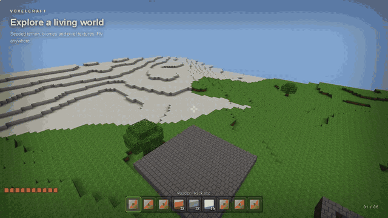

# VoxelCraft

**One-shot build · 11h 9m · 8 Qwen agents · 100.74M tokens processed · 881,597 output tokens.**

Built with **Qwen 3.8 Flash Next** in Codex.

One-shot means a single user prompt for the final build, including agent reviews and fixes. Token totals include repeated input processing.

A browser voxel game using plain JavaScript and WebGL2, with mining, crafting, building, water, falling sand, and a day/night cycle.

Mined blocks drop as mini textured cubes of that block that float and bob in the world. That item mesh is rebuilt every frame (spin + bob), so it streams from the mesher's scratch buffers instead of allocating new typed arrays each frame.



## Run

Requires Python 3 and a desktop browser with WebGL2.

```sh
git clone git@github.com:lzyang2000/voxelcraft-strata-qwen3.8fn.git
cd voxelcraft-strata-qwen3.8fn
python3 -m http.server 8000 --bind 127.0.0.1
```

Open http://localhost:8000 and click the game to capture the mouse. No build step or package installation is needed.

## Controls

WASD to move, Space to jump, left click to mine, right click to place, and 1–9 to select a block. E opens inventory, C opens crafting, F toggles flying, and Esc opens the menu.

Save/load from the menu or export/import a world as JSON. Saves stay in your browser.

## Tests

With Node.js installed:

```sh
for test in tools/test-*.js; do node "$test" || exit 1; done
```

## Disclaimer

Done purely for model capability evaluation purposes. VoxelCraft is an experimental, AI-generated project and may contain bugs. It is not affiliated with or endorsed by Mojang or Microsoft.
